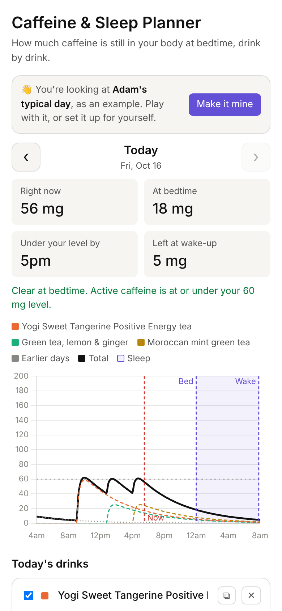

# Caffeine & Sleep Planner

A small, private web app that shows how caffeine from each drink decays through the day and how much is still in your body at bedtime. It also keeps a simple daily log so you can see, over time, whether late caffeine actually lines up with worse sleep.

**Live:** https://adamborecki.github.io/caffeine/



## What it does

### Plan the day
- Plots each drink's caffeine curve and the total. Your sleep window is shaded, and there are markers for bedtime, wake-up, and now.
- Shows caffeine **right now**, **at bedtime**, **when you drop under your comfort level**, and **left at wake-up**.
- For every drink, gives the **latest time you could have it** and still be under your level at bedtime.
- Includes a preset library (tea, coffee, Celsius, preworkout, and more). You can save custom drinks, and rename, duplicate, or remove any of them. Celsius gets a pour-size slider.
- Every time control has **‹ ›** buttons that move it 15 minutes.

### Log and reflect
- **Day navigator:** each day's drinks are saved by date. Go back to log a day after the fact.
- **Usual day:** new days start from a template you set. Tweak each day to match what you actually had.
- **Leftovers from earlier days** use what you logged, and assume your routine for days you didn't log.
- **Check-ins, all optional:**
  - Morning: sleep 1–5, hours, sleep score, note
  - Evening: energy and mood 1–5, note
- **History:** each day's total and bedtime caffeine, the next night's sleep rating, plus an honest under-vs-over comparison that shows its sample size.

### For anyone
- Opens on an example (Adam's typical day). **Make it mine** asks how hard caffeine hits you and how long it lasts, then starts you fresh.
- **Sensitivity** (your "OK at bed" level) and **how long caffeine lasts** (half-life) are separate settings, because they're different things.

## The model, in plain English

Each drink is absorbed over about the first hour, then cleared at a steady rate set by your **half-life**. Most adults are around 5 hours, but it ranges from roughly 2 to 10 hours depending on genetics, smoking, pregnancy, oral contraceptives, liver function, and medications.

Technically it's a one-compartment model with first-order absorption (ka = 3/h) and first-order elimination (ke = ln 2 / half-life):

```
C(t) = dose · ka / (ka − ke) · (e^(−ke·dt) − e^(−ka·dt)),   dt = t − doseTime
```

The mg shown is the amount left in your body, not a blood concentration.

## Limitations

- Your real half-life is unknown without testing. Adjust it until the results match how you sleep.
- The "OK at bed" level is a personal choice, not a clinical threshold.
- Preset caffeine values are typical servings. Brew strength and brands vary, so check labels.
- It doesn't model tolerance, food, L-theanine, or other individual differences.
- The history comparison is correlation on a small sample, not cause and effect.

## Disclaimer

**Educational only, not medical advice.** If you're pregnant, take medication, or have a heart condition, talk to a clinician about caffeine. Sources are listed in the app under "How this works & sources".

## Privacy

There are no accounts, no server, and no analytics. Everything stays in your browser's `localStorage`. Use **Your data → Export** for a backup, or to move your data to another device.

## Run it

Open `index.html` in a browser. There's no build step: plain HTML, CSS, and JS, with Chart.js from a CDN. Pushing to `main` deploys to GitHub Pages through `.github/workflows/static.yml`.

To run the end-to-end tests (headless Chromium via Playwright):

```sh
node tests/e2e.mjs            # ~40 checks
node tests/e2e.mjs --shots    # also writes screenshots to tests/.out/
```

## For contributors and future sessions

- [`docs/NOTES.md`](docs/NOTES.md): the full handoff (architecture, data model, decisions, roadmap).
- [`CLAUDE.md`](CLAUDE.md): short working rules for coding agents.

## License

[MIT](LICENSE)
